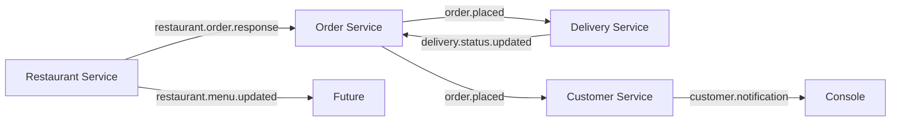

# QuickBite — Food Delivery Microservices Platform

A microservices-based backend for a food delivery platform, built as part of the **IT4020 — Modern Topics in IT** module at SLIIT.

## Architecture

```
                              ┌──────────────────┐
                              │   API Gateway    │  Spring Cloud Gateway (8080)
                              └────────┬─────────┘
            ┌──────────────┬───────────┼────────────┬───────────────┐
            ▼              ▼           ▼            ▼               │
     ┌────────────┐  ┌──────────┐ ┌──────────┐ ┌────────────┐       │
     │ Restaurant │  │  Order   │ │ Delivery │ │  Customer  │       │
     │ 8081 REST  │◀─┤  8082    ├▶│  8083    │ │ 8084 REST  │       │
     │ 9091 gRPC  │  │          │ │          │ │ 9094 gRPC  │       │
     └─────┬──────┘  └──┬───┬───┘ └────┬─────┘ └─────┬──────┘       │
           │   gRPC ◀───┘   └───▶ gRPC │              │              │
           │   QuoteOrder    ResolveCustomer           │              │
           ▼                  ▼          ▼             ▼              │
     ┌──────────────────────────────────────────────────────────┐    │
     │          Apache Kafka 4 (KRaft) — async domain events     │    │
     └──────────────────────────────────────────────────────────┘    │
     ┌──────────────────────────────────────────────────────────┐    │
     │      PostgreSQL 16 — one database per service             │    │
     └──────────────────────────────────────────────────────────┘    │
```

All services are **Java 25 / Spring Boot 4**, built from one Maven reactor. See
[docs/MIGRATION_PLAN.md](docs/MIGRATION_PLAN.md) for the Go → Spring Boot migration design.

## Tech Stack

| Layer              | Technology                                                   |
|--------------------|--------------------------------------------------------------|
| Language / runtime | Java 25 (LTS), virtual threads, compact object headers, AOT cache |
| Framework          | Spring Boot 4.0, Spring Data JPA (Hibernate 7), Jackson 3     |
| API Gateway        | Spring Cloud Gateway (WebFlux)                               |
| Sync RPC           | gRPC via Spring gRPC 1.0 (contracts in `grpc-contracts/`)    |
| Messaging          | Apache Kafka 4.1 (KRaft, no ZooKeeper)                       |
| Databases          | PostgreSQL 16 (one per service), Liquibase migrations        |
| API Docs           | springdoc / OpenAPI 3                                        |
| Containerization   | One shared multi-stage Dockerfile (jlink JRE + AOT cache), Docker Compose |

## gRPC: server-side order validation & pricing

Kafka carries asynchronous events; gRPC is used where order-service needs an answer
*before* it can respond. When an order is placed, order-service calls two services
**concurrently** (2 s deadline, retry on `UNAVAILABLE`):

| RPC | Server | Purpose |
|-----|--------|---------|
| `quickbite.restaurant.v1.RestaurantCatalog/QuoteOrder` | restaurant-service :9091 | Restaurant active? Items on its menu and available? Authoritative names, prices, total |
| `quickbite.customer.v1.CustomerDirectory/ResolveCustomer` | customer-service :9094 | Customer exists and is active; resolves a saved `address_id` to a delivery address |

Clients can no longer set prices: `unit_price` and `menu_item_name` in the request are ignored.
Validation failures return `400`, and an unreachable dependency returns `503`. Inspect the services
with reflection (`grpcurl -plaintext localhost:9091 list`) after publishing the port.

## Kafka Event Flow



Events are published only after the database transaction commits.

## Prerequisites

- Docker Desktop (Docker Engine 20.10+ and Docker Compose V2)
- About 2.5 GB of RAM for Docker. The whole stack runs within ~2.4 GB of memory limits.

## Quick Start

```bash
# Clone the repository
git clone <repo-url>
cd quickbite

# Start all services
docker compose up --build

# Wait for all services to be healthy (the first build downloads dependencies)
```

Run the end-to-end smoke test (REST → gRPC → Kafka → DB) once everything is healthy:

```bash
scripts/smoke-test.sh
```

Once running, all services are accessible through the API Gateway at `http://localhost:8080`.

## Service Endpoints

### API Gateway (http://localhost:8080)

All requests go through the gateway. Paths are forwarded to the appropriate service.

### Restaurant Service (port 8081)

| Method | Endpoint                                      | Description       |
|--------|-----------------------------------------------|-------------------|
| POST   | `/api/restaurants`                             | Create restaurant |
| GET    | `/api/restaurants?page=0&size=10&cuisineType=` | List restaurants  |
| GET    | `/api/restaurants/{id}`                        | Get by ID         |
| PUT    | `/api/restaurants/{id}`                        | Update            |
| DELETE | `/api/restaurants/{id}`                        | Soft delete       |
| POST   | `/api/restaurants/{id}/menu-items`             | Add menu item     |
| GET    | `/api/restaurants/{id}/menu-items`             | List menu items   |
| PUT    | `/api/restaurants/{id}/menu-items/{itemId}`    | Update item       |
| DELETE | `/api/restaurants/{id}/menu-items/{itemId}`    | Remove item       |

### Order Service (port 8082)

| Method | Endpoint                    | Description                      |
|--------|-----------------------------|----------------------------------|
| POST   | `/api/orders`               | Place order (validated + priced via gRPC; `delivery_address` or saved `address_id`) |
| GET    | `/api/orders`               | List (filter: customer_id, status, dates) |
| GET    | `/api/orders/{id}`          | Get order details                |
| PATCH  | `/api/orders/{id}/status`   | Update status                    |
| DELETE | `/api/orders/{id}`          | Cancel (only if PLACED)          |

### Delivery Service (port 8083)

| Method | Endpoint                            | Description          |
|--------|-------------------------------------|----------------------|
| POST   | `/api/drivers`                      | Register driver      |
| GET    | `/api/drivers?available=true`       | List drivers         |
| PUT    | `/api/drivers/{id}`                 | Update driver        |
| GET    | `/api/deliveries`                   | List deliveries      |
| GET    | `/api/deliveries/{id}`              | Delivery details     |
| PATCH  | `/api/deliveries/{id}/status`       | Update status        |
| GET    | `/api/deliveries/order/{orderId}`   | Get by order ID      |

### Customer Service (port 8084)

| Method | Endpoint                                  | Description      |
|--------|-------------------------------------------|------------------|
| POST   | `/api/customers`                          | Register         |
| GET    | `/api/customers`                          | List             |
| GET    | `/api/customers/{id}`                     | Get profile      |
| PUT    | `/api/customers/{id}`                     | Update           |
| DELETE | `/api/customers/{id}`                     | Soft delete      |
| POST   | `/api/customers/{id}/addresses`           | Add address      |
| GET    | `/api/customers/{id}/addresses`           | List addresses   |
| DELETE | `/api/customers/{id}/addresses/{addrId}`  | Remove address   |
| GET    | `/api/customers/{id}/order-history`       | Order history    |

## Swagger UI

| Service             | Direct URL                                     |
|---------------------|-------------------------------------------------|
| Restaurant Service  | http://localhost:8081/swagger-ui.html            |
| Order Service       | http://localhost:8082/swagger-ui.html            |
| Delivery Service    | http://localhost:8083/swagger-ui.html            |
| Customer Service    | http://localhost:8084/swagger-ui.html            |

## Seed Data

After all services are running, you can load seed data:

```bash
docker exec -i quickbite-postgres psql -U quickbite < scripts/seed-data.sql
```

This creates:
- 3 restaurants with 5 menu items each
- 5 customers with 2 addresses each
- 2 delivery drivers
- 3 sample orders in various statuses

## Stopping

```bash
docker compose down          # Stop and remove containers
docker compose down -v       # Also remove volumes (database data)
```

## Containers & JVM tuning

Every service image is built from [`docker/jvm.Dockerfile`](docker/jvm.Dockerfile) (`--build-arg SERVICE=<module>`):

1. Maven builds only the target module (BuildKit cache mount for `~/.m2`, reproducible jars).
2. `jlink` builds a trimmed, compressed JRE that every image shares as one layer.
3. The Spring Boot jar is extracted into dependency and application layers.
4. A training run records a **JDK 25 AOT cache** for faster startup. `--build-arg AOT_CACHE=false` skips it and gives smaller images.

JVM flags live in [`docker/jvm.options`](docker/jvm.options): Serial GC, heap set to 60% of the
container limit, compact object headers, exit on OOM, no perf-data mmap. Add more at deploy time with the
`JDK_JAVA_OPTIONS` environment variable. Containers run as a non-root user on a read-only root filesystem.

## Team Contributions

| Member   | Service             | Technology         |
|----------|---------------------|--------------------|
| Member A | restaurant-service  | Java / Spring Boot |
| Member B | order-service       | Java / Spring Boot (ported from Go) |
| Member C | delivery-service    | Java / Spring Boot (ported from Go) |
| Member D | customer-service    | Java / Spring Boot |

## Project Structure

```
quickbite/
├── pom.xml                   (Maven reactor / shared parent)
├── docker-compose.yml
├── docker/
│   ├── jvm.Dockerfile        (one Dockerfile for all services)
│   └── jvm.options           (JVM flags, used for AOT training and at runtime)
├── docs/MIGRATION_PLAN.md
├── scripts/
│   ├── init-databases.sql
│   ├── seed-data.sql
│   └── smoke-test.sh
├── grpc-contracts/           (.proto files + generated stubs)
├── api-gateway/              (Spring Cloud Gateway)
├── restaurant-service/       (Spring Boot + gRPC server)
├── order-service/            (Spring Boot + gRPC client)
├── delivery-service/         (Spring Boot)
└── customer-service/         (Spring Boot + gRPC server)
```
