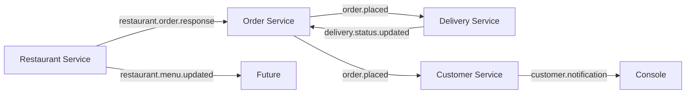

# QuickBite — Food Delivery Microservices Platform

A microservices-based backend for a food delivery platform, built as part of the **IT4020 — Modern Topics in IT** module at SLIIT.

## Architecture

```
                        ┌──────────────────────┐
                        │     API Gateway      │  Spring Cloud Gateway :8080
                        └──────────┬───────────┘
          ┌────────────────┬───────┴────────┬────────────────┐
          ▼                ▼                ▼                ▼
   ┌─────────────┐  ┌─────────────┐  ┌─────────────┐  ┌─────────────┐
   │  Restaurant │  │    Order    │  │   Delivery  │  │   Customer  │
   │  :8081 REST │  │  :8082 REST │  │  :8083 REST │  │  :8084 REST │
   │  :9091 gRPC │  │             │  │             │  │  :9094 gRPC │
   └──────▲──────┘  └──┬───────┬──┘  └─────────────┘  └──────▲──────┘
          │   gRPC     │       │                  gRPC       │
          └────────────┘       └─────────────────────────────┘
           QuoteOrder                  ResolveCustomer

   every service publishes/consumes events and owns its own database
   ┌────────────────────────────────────────────────────────────────┐
   │         Apache Kafka 4.1 (KRaft) - async domain events         │
   └────────────────────────────────────────────────────────────────┘
   ┌────────────────────────────────────────────────────────────────┐
   │            PostgreSQL 16 - one database per service            │
   └────────────────────────────────────────────────────────────────┘
```

All services are **Java 25 / Spring Boot 4**, built from one Maven reactor. See
[docs/MIGRATION_PLAN.md](docs/MIGRATION_PLAN.md) for the Go → Spring Boot migration design.

## Tech Stack

| Layer              | Technology                                                                |
|--------------------|---------------------------------------------------------------------------|
| Language / runtime | Java 25 (LTS), virtual threads, compact object headers, AOT cache         |
| Framework          | Spring Boot 4.0, Spring Data JPA (Hibernate 7), Jackson 3                 |
| API Gateway        | Spring Cloud Gateway (WebFlux)                                            |
| Sync RPC           | gRPC via Spring gRPC 1.0 (contracts in `grpc-contracts/`)                 |
| Messaging          | Apache Kafka 4.1 (KRaft, no ZooKeeper)                                    |
| Databases          | PostgreSQL 16 (one per service), Liquibase migrations                     |
| API Docs           | springdoc / OpenAPI 3                                                     |
| Containerization   | One shared multi-stage Dockerfile (jlink JRE + AOT cache), Docker Compose |

## gRPC: server-side order validation & pricing

Kafka carries asynchronous events; gRPC is used where order-service needs an answer
*before* it can respond. When an order is placed, order-service calls two services
**concurrently** (2 s deadline, retry on `UNAVAILABLE`):

| RPC                                                       | Server                   | Purpose                                                                                |
|-----------------------------------------------------------|--------------------------|----------------------------------------------------------------------------------------|
| `quickbite.restaurant.v1.RestaurantCatalog/QuoteOrder`    | restaurant-service :9091 | Restaurant active? Items on its menu and available? Authoritative names, prices, total |
| `quickbite.customer.v1.CustomerDirectory/ResolveCustomer` | customer-service :9094   | Customer exists and is active; resolves a saved `address_id` to a delivery address     |

Clients can no longer set prices: `unit_price` and `menu_item_name` in the request are ignored.
Validation failures return `400`, and an unreachable dependency returns `503`. Inspect the services
with reflection (`grpcurl -plaintext localhost:9091 list`) after publishing the port.

## Kafka Event Flow



Events are published only after the database transaction commits.

## Prerequisites

- Docker Desktop (Docker Engine 20.10+ and Docker Compose V2)
- About 2.5 GB of RAM for Docker. The whole stack runs within ~2.4 GB of memory limits.

## Quick Start

```bash
# Clone the repository
git clone <repo-url>
cd quickbite

# Start all services
docker compose up --build

# Wait for all services to be healthy (the first build downloads dependencies)
```

Run the end-to-end smoke test (REST → gRPC → Kafka → DB) once everything is healthy:

```bash
scripts/smoke-test.sh
```

Once running, all services are accessible through the API Gateway at `http://localhost:8080`.

All published ports are bound to `127.0.0.1`, so the stack is reachable from your machine only. The
services have no built-in database password: to run one outside Docker (e.g. from your IDE), set
`SPRING_DATASOURCE_PASSWORD=quickbite123` (the Compose development password).

## Swagger UI

| Service            | Direct URL                            |
|--------------------|---------------------------------------|
| Restaurant Service | http://localhost:8081/swagger-ui.html |
| Order Service      | http://localhost:8082/swagger-ui.html |
| Delivery Service   | http://localhost:8083/swagger-ui.html |
| Customer Service   | http://localhost:8084/swagger-ui.html |

## Seed Data

After all services are running, you can load seed data:

```bash
docker exec -i quickbite-postgres psql -U quickbite < scripts/seed-data.sql
```

This creates:
- 3 restaurants with 5 menu items each
- 5 customers with 2 addresses each
- 2 delivery drivers
- 3 sample orders in various statuses

## Stopping

```bash
docker compose down          # Stop and remove containers
docker compose down -v       # Also remove volumes (database data)
```

## Deploying to Kubernetes

Manifests live in [`k8s/`](k8s) as Kustomize (built into `kubectl`, nothing else to install):

| Path                  | What it adds                                                                              |
|-----------------------|-------------------------------------------------------------------------------------------|
| `k8s/base`            | Namespace, Postgres and Kafka StatefulSets, the five services, probes, limits, hardening  |
| `k8s/overlays/local`  | Dev password, locally built `quickbite/*` images, gateway as a `LoadBalancer`              |
| `k8s/overlays/prod`   | GHCR images, password from a git-ignored file, Ingress with TLS, NetworkPolicies          |
| `k8s/vm`              | VM scripts used by `scripts/cloud-deploy.sh`: k3s + cert-manager bootstrap, deploy        |

The stack requests about 2.6 GiB of memory, so use a node with at least 4 GB of RAM (8 GB is comfortable).
Only the gateway is exposed; Postgres, Kafka, gRPC and the service REST ports stay inside the cluster.

### Local cluster (Docker Desktop, k3d, kind, minikube)

The local overlay reserves less memory (about 1.7 GiB of requests, same limits), so it fits a
Docker Desktop VM with 4 GB of memory and Kubernetes enabled (Settings → Kubernetes, kubeadm). Turn Kubernetes off
again afterwards to give the memory back; Compose does not need it.

```bash
docker compose build                       # builds quickbite/<service>:latest
kubectl apply -k k8s/overlays/local
kubectl -n quickbite get pods -w           # wait until everything is Running and 1/1
scripts/smoke-test.sh                      # Docker Desktop / k3s serve the gateway on localhost:8080
```

On kind, k3d or minikube, load the images into the cluster first (`kind load docker-image ...`,
`k3d image import ...`, or `minikube image load ...`) and use
`kubectl -n quickbite port-forward svc/api-gateway 8080:8080` to reach the gateway.

Seed data: `kubectl -n quickbite exec -i postgres-0 -- psql -U quickbite < scripts/seed-data.sql`

### Cloud VM in one command (DigitalOcean, Azure, AWS)

[`scripts/cloud-deploy.sh`](scripts/cloud-deploy.sh) turns a fresh Ubuntu VM into a k3s cluster and
deploys the **production overlay** onto it: GHCR images, Traefik ingress, Let's Encrypt TLS,
NetworkPolicies, and a generated database password. Only ports 80 and 443 are exposed.

1. **Build the images.** Push to `master` on GitHub (or run the *images* workflow by hand under
   *Actions*) and wait for all five jobs to finish. Then either make each `quickbite-*` package public
   (GitHub → your profile → *Packages* → package → *Package settings* → *Change visibility*), or keep
   them private and pass a token in step 3.
2. **Create the VM.** Ubuntu 24.04, x86, 8 GB of RAM, your SSH key:

   | Provider     | Size                          | SSH user    |
   |--------------|-------------------------------|-------------|
   | DigitalOcean | Basic Droplet, 8 GB / 4 vCPU  | `root`      |
   | Azure        | `Standard_B2ms` (8 GB)        | `azureuser` |
   | AWS EC2      | `t3.large` (8 GB)             | `ubuntu`    |

   In the provider's firewall (DO Cloud Firewall, Azure NSG, AWS security group) allow inbound
   **22** (your IP only), **80** and **443**. Don't open 6443; the script runs `kubectl` over SSH.
3. **Deploy** from your machine:
   ```bash
   scripts/cloud-deploy.sh root@203.0.113.10
   ```
   With private packages, add a GitHub token that has `read:packages`:
   `GHCR_USER=<github-user> GHCR_TOKEN=<token> scripts/cloud-deploy.sh root@203.0.113.10`.
   The first run installs k3s and cert-manager (about 2 minutes); later runs only redeploy.
   `TAG=sha-<commit>` deploys a specific build, and `HOST=api.example.com` uses your own domain
   instead of the free `<ip>.sslip.io` name.
4. **Test:**
   ```bash
   scripts/smoke-test.sh http://203.0.113.10.sslip.io
   ```

Run the script again at any time to redeploy. When you're done, **destroy the VM** in the provider's
console. These sizes bill roughly $0.07–0.09 an hour, but a stopped VM on Azure or AWS still bills for its disk.

### Production (k3s on a VM, or any managed cluster)

1. **Images.** Pushing to `master` runs [`.github/workflows/images.yml`](.github/workflows/images.yml),
   which publishes `ghcr.io/<owner>/quickbite-<service>` tagged `sha-<commit>` and `latest`.
   GHCR packages are private by default: make them public under *Package settings*, or create a pull
   secret (`kubectl -n quickbite create secret docker-registry ghcr ...`) and add it as `imagePullSecrets`.
2. **Cluster.** For a single VM, `curl -sfL https://get.k3s.io | sh -` gives Kubernetes with Traefik
   ingress, a LoadBalancer and local-path storage. For TLS, install
   [cert-manager](https://cert-manager.io/docs/installation/) and create a `ClusterIssuer` named
   `letsencrypt` (ACME HTTP-01 through the `traefik` ingress class).
3. **Configure.** Set your domain (and ingress class, if not Traefik) in
   [`k8s/overlays/prod/ingress.yaml`](k8s/overlays/prod/ingress.yaml), and create the secret file:
   ```bash
   cp k8s/overlays/prod/secrets.env.example k8s/overlays/prod/secrets.env   # set a strong password
   ```
4. **Deploy.**
   ```bash
   kubectl apply -k k8s/overlays/prod
   kubectl -n quickbite wait --for=condition=Available deployment --all --timeout=5m
   ```
   To ship new images, either pin `newTag: sha-<commit>` in
   [`k8s/overlays/prod/kustomization.yaml`](k8s/overlays/prod/kustomization.yaml) and re-apply
   (recommended: reproducible and easy to roll back), or keep `latest` and run
   `kubectl -n quickbite rollout restart deployment`.

Notes:
- Postgres and Kafka run in-cluster as single-replica StatefulSets, like in Compose. For real production,
  use a managed Postgres and managed Kafka (or Strimzi), and update `SPRING_DATASOURCE_URL` /
  `SPRING_KAFKA_BOOTSTRAP_SERVERS`.
- gRPC calls go through ClusterIP Services, and gRPC keeps one long-lived HTTP/2 connection. If you scale
  restaurant-service or customer-service past one replica, add client-side load balancing (headless
  Service + `dns:///` target) or a service mesh, or most calls will reach a single pod.

## Containers & JVM tuning

Every service image is built from [`docker/jvm.Dockerfile`](docker/jvm.Dockerfile) (`--build-arg SERVICE=<module>`):

1. Maven builds only the target module (BuildKit cache mount for `~/.m2`, reproducible jars).
2. `jlink` builds a trimmed JRE (with a JDK CDS archive) that every image shares as one layer.
3. The Spring Boot jar is extracted into dependency and application layers.
4. A training run records a **JDK 25 AOT cache** for faster startup. `--build-arg AOT_CACHE=false` skips it and gives smaller images.

JVM flags live in [`docker/jvm.options`](docker/jvm.options): Serial GC, heap set to 60% of the
container limit, compact object headers, exit on OOM, no perf-data mmap. Add more at deploy time with the
`JDK_JAVA_OPTIONS` environment variable. Containers run as a non-root user on a read-only root filesystem.

## Project Structure

```
quickbite/
├── pom.xml                   (Maven reactor / shared parent)
├── docker-compose.yml
├── k8s/                      (Kustomize: base + local/prod overlays)
├── .github/workflows/        (image build -> GHCR)
├── docker/
│   ├── jvm.Dockerfile        (one Dockerfile for all services)
│   └── jvm.options           (JVM flags, used for AOT training and at runtime)
├── docs/MIGRATION_PLAN.md
├── scripts/
│   ├── init-databases.sql
│   ├── seed-data.sql
│   └── smoke-test.sh
├── grpc-contracts/           (.proto files + generated stubs)
├── api-gateway/              (Spring Cloud Gateway)
├── restaurant-service/       (Spring Boot + gRPC server)
├── order-service/            (Spring Boot + gRPC client)
├── delivery-service/         (Spring Boot)
└── customer-service/         (Spring Boot + gRPC server)
```
