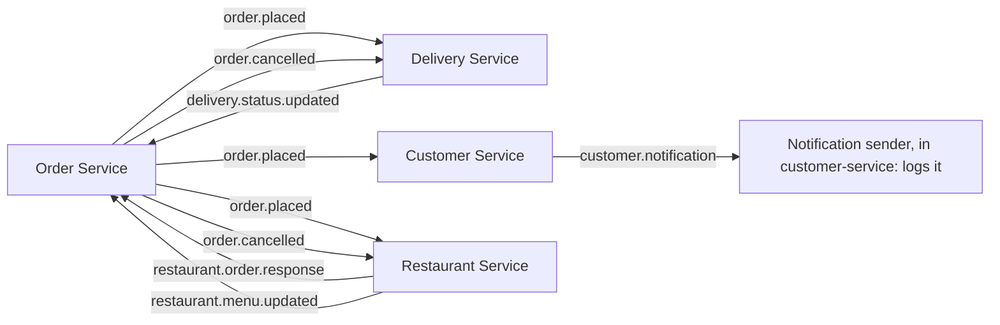

# QuickBite — Food Delivery Microservices Platform

A microservices-based backend for a food delivery platform, built as part of the **IT4020 — Modern Topics in IT** module at SLIIT.

## Architecture

```
                        ┌──────────────────────┐
                        │     API Gateway      │  Spring Cloud Gateway :8080
                        └──────────┬───────────┘
          ┌────────────────┬───────┴────────┬────────────────┐
          ▼                ▼                ▼                ▼
   ┌─────────────┐  ┌─────────────┐  ┌─────────────┐  ┌─────────────┐
   │  Restaurant │  │    Order    │  │   Delivery  │  │   Customer  │
   │  :8081 REST │  │  :8082 REST │  │  :8083 REST │  │  :8084 REST │
   │  :9091 gRPC │  │             │  │             │  │  :9094 gRPC │
   └──────▲──────┘  └──┬───────┬──┘  └─────────────┘  └──────▲──────┘
          │   gRPC     │       │                  gRPC       │
          └────────────┘       └─────────────────────────────┘
           QuoteOrder                  ResolveCustomer

   every service publishes/consumes events and owns its own database
   ┌────────────────────────────────────────────────────────────────┐
   │         Apache Kafka 4.1 (KRaft) - async domain events         │
   └────────────────────────────────────────────────────────────────┘
   ┌────────────────────────────────────────────────────────────────┐
   │            PostgreSQL 16 - one database per service            │
   └────────────────────────────────────────────────────────────────┘
```

All services are **Java 25 / Spring Boot 4**, built from one Maven reactor.

## Tech Stack

| Layer              | Technology                                                                |
|--------------------|---------------------------------------------------------------------------|
| Language / runtime | Java 25 (LTS), virtual threads, compact object headers, AOT cache         |
| Framework          | Spring Boot 4.0, Spring Data JPA (Hibernate 7), Jackson 3                 |
| API Gateway        | Spring Cloud Gateway (WebFlux)                                            |
| Identity           | Keycloak 26 (OAuth 2.0 / OpenID Connect), JWT access tokens, Spring Security 7 resource servers |
| Sync RPC           | gRPC via Spring gRPC 1.0 (contracts in `grpc-contracts/`)                 |
| Messaging          | Apache Kafka 4.1 (KRaft, no ZooKeeper), transactional outbox + inbox      |
| Resilience         | Resilience4j circuit breakers (gRPC calls, gateway routes), dead-letter topics |
| Observability      | Micrometer → Prometheus, OpenTelemetry traces → Tempo, Grafana dashboards  |
| Databases          | PostgreSQL 16 (one per service), Liquibase migrations                     |
| API Docs           | springdoc / OpenAPI 3                                                     |
| Containerization   | One shared multi-stage Dockerfile (jlink JRE + AOT cache), Docker Compose |

## gRPC: server-side order validation & pricing

Kafka carries asynchronous events; gRPC is used where order-service needs an answer
*before* it can respond. When an order is placed, order-service calls two services
**concurrently** (2 s deadline, retry on `UNAVAILABLE`):

| RPC                                                       | Server                   | Purpose                                                                                |
|-----------------------------------------------------------|--------------------------|----------------------------------------------------------------------------------------|
| `quickbite.restaurant.v1.RestaurantCatalog/QuoteOrder`    | restaurant-service :9091 | Restaurant active? Items on its menu and available? Authoritative names, prices, total |
| `quickbite.customer.v1.CustomerDirectory/ResolveCustomer` | customer-service :9094   | Customer exists and is active; resolves a saved `address_id` to a delivery address     |

Clients can no longer set prices: `unit_price` and `menu_item_name` in the request are ignored.
Validation failures return `400`, and an unreachable dependency returns `503`.

gRPC calls are authenticated like HTTP ones: order-service forwards the caller's own access token, so
the user's identity reaches restaurant-service and customer-service. To inspect a service with
reflection, publish its port and pass a token:
`grpcurl -plaintext -H "authorization: Bearer $TOKEN" localhost:9091 list`.

## Authentication and authorisation

[Keycloak](keycloak/README.md) is the identity provider (realm `quickbite`, served under `/auth`).
Clients log in there, get a JWT access token, and send it as `Authorization: Bearer <token>`.

- **The gateway** rejects requests without a valid token with `401`. Only browsing restaurants and menus
  (`GET /api/restaurants/**`) is public.
- **Each service** validates the token again (signature with the realm's keys, issuer, expiry) and checks
  roles and ownership, answering `403` for anything else. Services own their data by Keycloak user id:
  `restaurants.owner_id`, `customers.user_id`, `drivers.user_id`, and `orders.customer_user_id`.
- **Shared code** lives in the [`security`](security) module (`@EnableQuickBiteSecurity`, `CurrentUser`).

| Role | Can |
|------|-----|
| `customer` | create one customer profile (`POST /api/customers`, `GET /api/customers/me`); manage its addresses; place, read, list and cancel **its own** orders; read its order history |
| `restaurant` | create restaurants; change **its own** restaurants and their menus; see, accept and reject **its own** restaurants' orders |
| `driver` | register once as a driver (`POST /api/drivers`, `GET /api/drivers/me`); update its profile; see and move **the deliveries assigned to it** |
| `admin` | everything, including listing all customers, drivers, orders and deliveries, and setting an order's status directly |

Rows created before authentication existed (and the seed data) have no owner, so only admins can
change them. Kafka consumers and the outbox are not user requests and are not checked.

**Development users** (Compose and the local Kubernetes overlay, password `quickbite123`): `admin`,
`customer1`, `customer2`, `restaurant1`, `driver1`. Get a token with:

```bash
TOKEN=$(curl -s -X POST http://localhost:8180/auth/realms/quickbite/protocol/openid-connect/token \
  -d grant_type=password -d client_id=quickbite-app -d username=customer1 -d password=quickbite123 | jq -r .access_token)
curl -H "Authorization: Bearer $TOKEN" localhost:8080/api/customers/me
```

The `quickbite-app` client also supports the authorization code flow with PKCE for browser and mobile apps
(redirect URIs `http://localhost:3000/*` and `http://localhost:5173/*`; add yours in the realm). The
password grant used above is for scripts and the smoke test; disable *Direct access grants* on the client
if you don't need it. Keycloak's admin console is at <http://localhost:8180/auth/admin> (`admin` / `admin`
in development). In production the realm has **no users**: create them, and assign roles, in the admin
console (`kubectl -n quickbite port-forward svc/keycloak 8180:8080`).

All JSON bodies, requests and responses, are **snake_case** (`cuisine_type`, `address_line`, `total_amount`).

## Kafka Event Flow



`order.cancelled` is published whenever an order becomes CANCELLED: the customer cancels it
(`DELETE /api/orders/{id}`), its status is set to CANCELLED, or the restaurant rejects it. delivery-service
then cancels the delivery if it is still ASSIGNED and frees the driver. A delivery that is already picked up
is left alone. Kafka gives no ordering between topics, so the cancellation can arrive before `order.placed`.
delivery-service records cancelled orders in `cancelled_orders` and never assigns a driver to one.

**Restaurants accept or reject orders.** restaurant-service keeps its own list of the orders placed with each
restaurant (from `order.placed` and `order.cancelled`). The restaurant's owner answers each waiting order:

| Endpoint (owner or admin) | Effect |
|---------------------------|--------|
| `GET /api/restaurants/{id}/orders?status=PLACED` | the restaurant's orders, newest first (`status` optional: `PLACED` = waiting, `ACCEPTED`, `REJECTED`, `CANCELLED`) |
| `POST /api/restaurants/{id}/orders/{order_id}/accept` | publishes `restaurant.order.response` CONFIRMED; order-service moves the order from PLACED to CONFIRMED |
| `POST /api/restaurants/{id}/orders/{order_id}/reject` with `{"reason": "..."}` | publishes REJECTED; order-service cancels the order, which frees its driver |

An order can be answered once, and only while waiting (otherwise `409`). order-service applies a confirmation only
to an order that is still PLACED, so a late confirmation never revives a cancelled order.

**Notifications and menu updates are logged.** `customer.notification` is read by a notification sender in
customer-service (its own consumer group, `notification-sender`), which logs each one as
`NOTIFY customer=<id> type=<type>: <message>`; replace the log line with an email or SMS client to send real ones.
order-service logs `restaurant.menu.updated` (it prices every order live over gRPC, so it keeps no menu copy).

Every topic also has a dead-letter topic, `<topic>.DLT`, for events a consumer could not process.

**Topics are declared, not auto-created.** The broker's auto-creation is off. Every service declares the full list
([`Topics`](messaging/src/main/java/com/quickbite/messaging/Topics.java)) at startup, so whichever starts first
creates them: 3 partitions and 7 days' retention for each topic, 1 partition and 30 days for each `.DLT`, replication
factor 1 (one broker). Change them under `quickbite.messaging.topics.*`; existing topics are updated to match
(`spring.kafka.admin.modify-topic-configs`).

**Statuses only move forward.** Orders: `PLACED → CONFIRMED → PREPARING → READY → PICKED_UP → DELIVERED`, with
`CANCELLED` possible until pickup (a driver may also pick up an order the kitchen hasn't marked ready). Deliveries:
`ASSIGNED → PICKED_UP → EN_ROUTE → DELIVERED`, cancellable only while `ASSIGNED`. `DELIVERED` and `CANCELLED` are
final. Any other change, even by an admin, is refused with `409`; setting the current status again is a no-op. Events
follow the same rules: a late delivery update never revives a cancelled order.

## Reliable messaging: transactional outbox

Services never call Kafka from business code. The shared [`messaging`](messaging) module handles it:

1. **Outbox.** `Outbox.publish(topic, key, payload)` inserts the event into the service's own
   `outbox_events` table **in the same transaction** as the business change (order saved, delivery
   assigned, menu item updated...). Both commit, or neither does. A rolled-back order is never announced.
   An event is never lost when Kafka is down or the service crashes right after committing.
2. **Relay.** A background thread (`OutboxRelay`) sends committed events to Kafka in order, waits for
   acknowledgements, and marks them published. While Kafka is unreachable it retries with backoff. The
   events wait in the table, visible as `quickbite_outbox_pending` in Grafana. With several replicas, a
   Postgres advisory lock lets only one relay run at a time, which keeps the order. Published rows are
   deleted after 7 days.
3. **Inbox.** Delivery is *at least once*, so consumers deduplicate. Each Kafka record carries an
   `event-id` header. A listener records that id in `processed_events` in the same transaction as its own
   changes, and skips ids it has already processed.
4. **Retries and dead letters.** A listener that throws is retried with exponential backoff (5 times,
   500 ms → 10 s). After that the record goes to `<topic>.DLT`. Malformed events go there immediately,
   so one bad record never blocks a partition.

The tables are created by a Liquibase changelog shipped in the module
(`db/changelog/messaging/001-outbox-inbox.sql`), included by each service's master changelog.
Trace context is stored with each event, so a trace follows an order from the HTTP request, through the
outbox and Kafka, into every consumer.

```bash
# Inspect the outbox of a service
docker exec -it quickbite-postgres psql -U quickbite -d quickbite_order_db \
  -c "SELECT id, topic, created_at, published_at, attempts, last_error FROM outbox_events ORDER BY id DESC LIMIT 10"
```

## Circuit breakers

| Where | Breakers | What counts as a failure | When open |
|-------|----------|--------------------------|-----------|
| order-service → gRPC | `restaurant-service`, `customer-service` | `UNAVAILABLE`, `DEADLINE_EXCEEDED`, `INTERNAL`, ... (not `NOT_FOUND`/`INVALID_ARGUMENT`, which are answers) | `POST /api/orders` fails fast with `503 ... unavailable (circuit open)`, without sending the RPC |
| api-gateway → services | one per service | connection refused, response timeout | `503 {"error": "<service> is temporarily unavailable"}` with `Retry-After` |

Both open at a 50% failure rate over the last 20 calls (after at least 10), stay open for 10 s, then let
3 trial calls through. The order-service settings are under `quickbite.grpc.circuit-breaker` in its
`application.yml`. Breaker state is on the Grafana dashboard (`resilience4j_circuitbreaker_state`).

## Observability

| Signal  | How | Where |
|---------|-----|-------|
| Metrics | Micrometer, `/actuator/prometheus` on every service, scraped by Prometheus every 15 s | Grafana dashboard **QuickBite overview**, Prometheus at <http://localhost:9090> |
| Traces  | OpenTelemetry (Micrometer Tracing), exported over OTLP to Grafana Tempo. Covers HTTP, gRPC, Kafka and the outbox relay | Grafana → Explore → Tempo, or click an exemplar dot on a latency graph |
| Logs    | Every log line carries `traceId`/`spanId`, so you can jump from a trace to the matching logs | `docker compose logs <service>` |

Prometheus *stores* the metrics and Grafana *displays* them. Tempo plays the same storage role for traces.

Open **Grafana at <http://localhost:3000>** (no login; it is bound to localhost only). The home dashboard shows
request rate, 5xx ratio and p95 latency per service, circuit-breaker state, gRPC calls, outbox backlog
and relay throughput, Kafka listeners, duplicate deliveries, and JVM heap/CPU. Tempo also builds a
**service map** from the traces (Explore → Tempo → Service Graph).

Every request is traced (`TRACING_SAMPLING_PROBABILITY`, default `1.0`; lower it under real load). Trace
export is on only when `MANAGEMENT_OPENTELEMETRY_TRACING_EXPORT_OTLP_ENDPOINT` is set. Compose and the
Kubernetes overlays set it, so a service started from the IDE stays quiet.

## Prerequisites

- Docker Desktop (Docker Engine 20.10+ and Docker Compose V2)
- About 4 GB of RAM for Docker (Docker Desktop → Settings → Resources). The services, Postgres and Kafka
  run within ~2.4 GB of memory limits, Prometheus, Tempo and Grafana add up to ~0.9 GB, and Keycloak ~0.75 GB
  (limits; actual use is lower).

## Quick Start

```bash
# Clone the repository
git clone <repo-url>
cd quickbite

# Start all services
docker compose up --build

# Wait for all services to be healthy (the first build downloads dependencies)
```

Run the end-to-end smoke test (login → REST → gRPC → Kafka → DB, plus 401/403 checks) once everything is
healthy. It logs in as the development users:

```bash
scripts/smoke-test.sh
```

Once running, all services are accessible through the API Gateway at `http://localhost:8080`, Keycloak
at `http://localhost:8180/auth`, and Grafana at `http://localhost:3000`. The first start of Keycloak takes
about a minute (it builds and creates its database).

All published ports are bound to `127.0.0.1`, so the stack is reachable from your machine only. The
services have no built-in database password: to run one outside Docker (e.g. from your IDE), set
`SPRING_DATASOURCE_PASSWORD=quickbite123` (the Compose development password).

## Swagger UI

| Service            | Direct URL                            |
|--------------------|---------------------------------------|
| Restaurant Service | http://localhost:8081/swagger-ui.html |
| Order Service      | http://localhost:8082/swagger-ui.html |
| Delivery Service   | http://localhost:8083/swagger-ui.html |
| Customer Service   | http://localhost:8084/swagger-ui.html |

## Seed Data

After all services are running, you can load seed data:

```bash
docker exec -i quickbite-postgres psql -U quickbite < scripts/seed-data.sql
```

This creates (all admin-managed: no account owns them, so only `admin` can change them):
- 3 restaurants with 5 menu items each
- 5 customers with 2 addresses each
- 2 delivery drivers
- 3 sample orders in various statuses

## Stopping

```bash
docker compose down          # Stop and remove containers
docker compose down -v       # Also remove volumes (database data)
```

## Continuous integration

Two GitHub Actions workflows in [`.github/workflows`](.github/workflows):

| Workflow | Runs on | What it does |
|----------|---------|--------------|
| [`ci.yml`](.github/workflows/ci.yml) | every pull request into `master` (and by hand) | **checks**: `mvn verify` (unit tests and the Testcontainers outbox test), Compose and Kustomize files render, shell scripts parse. **smoke**: builds the images, starts the whole stack in Docker Compose and runs `scripts/smoke-test.sh` against it; on failure it prints every container's logs |
| [`images.yml`](.github/workflows/images.yml) | every push to `master` (and by hand) | runs the tests again, and only if they pass builds the five images and pushes them to GHCR |

To block merging until CI passes: GitHub → *Settings* → *Branches* → add a branch protection rule (or ruleset)
for `master` → *Require status checks to pass before merging* → select `checks` and `smoke`.

## Deploying to Kubernetes

Manifests live in [`k8s/`](k8s) as Kustomize (built into `kubectl`, nothing else to install):

| Path                  | What it adds                                                                              |
|-----------------------|-------------------------------------------------------------------------------------------|
| `k8s/base`            | Namespace, Postgres and Kafka StatefulSets, the five services, probes, limits, hardening  |
| `k8s/overlays/local`  | Dev password, locally built `quickbite/*` images, gateway as a `LoadBalancer`              |
| `k8s/overlays/prod`   | GHCR images, password from a git-ignored file, Ingress with TLS, NetworkPolicies          |
| `k8s/vm`              | VM scripts used by `scripts/cloud-deploy.sh`: k3s + cert-manager bootstrap, deploy        |
| `observability`       | Kustomize component used by both overlays: Prometheus, Tempo, Grafana; turns on trace export |
| `keycloak`            | Kustomize component used by both overlays: Keycloak + realm; `keycloak/dev-users` adds test users (local only) |

The stack requests about 2.6 GiB of memory, plus about 0.6 GiB for observability and 0.6 GiB for Keycloak,
so use a node with at least 4 GB of RAM (8 GB is comfortable). Only the gateway's `/api` paths and Keycloak's
login and token endpoints (`/auth/realms`, `/auth/resources`) are exposed. Postgres, Kafka, gRPC, the service
REST ports, `/actuator`, Keycloak's admin console and Grafana stay inside the cluster. Open Grafana with
`kubectl -n quickbite port-forward svc/grafana 3000:3000`. To run without observability, remove the
`components:` entry from the overlay.

### Local cluster (Docker Desktop, k3d, kind, minikube)

The local overlay reserves less memory (about 1.7 GiB of requests for the application, 0.6 GiB for
observability, same limits), so it fits a Docker Desktop VM with 4 GB of memory (6 GB is more comfortable) and Kubernetes enabled (Settings → Kubernetes, kubeadm). Turn Kubernetes off
again afterwards to give the memory back; Compose does not need it.

```bash
docker compose build                       # builds quickbite/<service>:latest
kubectl apply -k k8s/overlays/local
kubectl -n quickbite get pods -w           # wait until everything is Running and 1/1
scripts/smoke-test.sh                      # Docker Desktop / k3s serve the gateway on localhost:8080
```

On kind, k3d or minikube, load the images into the cluster first (`kind load docker-image ...`,
`k3d image import ...`, or `minikube image load ...`) and use
`kubectl -n quickbite port-forward svc/api-gateway 8080:8080` to reach the gateway.

Seed data: `kubectl -n quickbite exec -i postgres-0 -- psql -U quickbite < scripts/seed-data.sql`

### Cloud VM in one command (DigitalOcean, Azure, AWS)

[`scripts/cloud-deploy.sh`](scripts/cloud-deploy.sh) turns a fresh Ubuntu VM into a k3s cluster and
deploys the **production overlay** onto it: GHCR images, Traefik ingress, Let's Encrypt TLS,
NetworkPolicies, and a generated database password. Only ports 80 and 443 are exposed.

1. **Build the images.** Push to `master` on GitHub (or run the *images* workflow by hand under
   *Actions*) and wait for all five jobs to finish. Then either make each `quickbite-*` package public
   (GitHub → your profile → *Packages* → package → *Package settings* → *Change visibility*), or keep
   them private and pass a token in step 3.
2. **Create the VM.** Ubuntu 24.04, x86, 8 GB of RAM, your SSH key:

   | Provider     | Size                          | SSH user    |
   |--------------|-------------------------------|-------------|
   | DigitalOcean | Basic Droplet, 8 GB / 4 vCPU  | `root`      |
   | Azure        | `Standard_B2ms` (8 GB)        | `azureuser` |
   | AWS EC2      | `t3.large` (8 GB)             | `ubuntu`    |

   In the provider's firewall (DO Cloud Firewall, Azure NSG, AWS security group) allow inbound
   **22** (your IP only), **80** and **443**. Don't open 6443; the script runs `kubectl` over SSH.
3. **Deploy** from your machine:
   ```bash
   scripts/cloud-deploy.sh root@203.0.113.10
   ```
   With private packages, add a GitHub token that has `read:packages`:
   `GHCR_USER=<github-user> GHCR_TOKEN=<token> scripts/cloud-deploy.sh root@203.0.113.10`.
   The first run installs k3s and cert-manager (about 2 minutes); later runs only redeploy.
   `TAG=sha-<commit>` deploys a specific build, and `HOST=api.example.com` uses your own domain
   instead of the free `<ip>.sslip.io` name.
4. **Users.** The production realm has no users. Open the admin console through an SSH tunnel
   (`ssh -L 8180:localhost:8180 root@203.0.113.10 sudo k3s kubectl -n quickbite port-forward svc/keycloak 8180:8080`,
   then <http://localhost:8180/auth/admin>; user `admin`, password `keycloak_admin_password` from
   `/etc/quickbite/secrets.env` on the VM). In realm `quickbite`, create users and assign realm roles.
   For the smoke test, create `admin`, `customer1`, `customer2`, `restaurant1` and `driver1` with the
   matching roles and one password, and pass it as `SMOKE_PASSWORD`.
5. **Test:**
   ```bash
   SMOKE_PASSWORD=<their password> scripts/smoke-test.sh http://203.0.113.10.sslip.io
   ```

Run the script again at any time to redeploy. When you're done, **destroy the VM** in the provider's
console. These sizes bill roughly $0.07–0.09 an hour, but a stopped VM on Azure or AWS still bills for its disk.

### Production (k3s on a VM, or any managed cluster)

1. **Images.** Pushing to `master` runs [`.github/workflows/images.yml`](.github/workflows/images.yml),
   which runs the tests and then publishes `ghcr.io/<owner>/quickbite-<service>` tagged `sha-<commit>` and `latest`.
   GHCR packages are private by default: make them public under *Package settings*, or create a pull
   secret (`kubectl -n quickbite create secret docker-registry ghcr ...`) and add it as `imagePullSecrets`.
2. **Cluster.** For a single VM, `curl -sfL https://get.k3s.io | sh -` gives Kubernetes with Traefik
   ingress, a LoadBalancer and local-path storage. For TLS, install
   [cert-manager](https://cert-manager.io/docs/installation/) and create a `ClusterIssuer` named
   `letsencrypt` (ACME HTTP-01 through the `traefik` ingress class).
3. **Configure.** Set your domain (and ingress class, if not Traefik) in
   [`k8s/overlays/prod/ingress.yaml`](k8s/overlays/prod/ingress.yaml) and in `AUTH_PUBLIC_URL`
   (`https://<your-domain>/auth`) in [`k8s/overlays/prod/kustomization.yaml`](k8s/overlays/prod/kustomization.yaml),
   and create the secret file:
   ```bash
   cp k8s/overlays/prod/secrets.env.example k8s/overlays/prod/secrets.env   # set strong passwords
   ```
   After the first deploy, create users and give them roles in Keycloak's admin console.
4. **Deploy.**
   ```bash
   kubectl apply -k k8s/overlays/prod
   kubectl -n quickbite wait --for=condition=Available deployment --all --timeout=5m
   ```
   To ship new images, either pin `newTag: sha-<commit>` in
   [`k8s/overlays/prod/kustomization.yaml`](k8s/overlays/prod/kustomization.yaml) and re-apply
   (recommended: reproducible and easy to roll back), or keep `latest` and run
   `kubectl -n quickbite rollout restart deployment`.

Notes:
- Postgres and Kafka run in-cluster as single-replica StatefulSets, like in Compose. For real production,
  use a managed Postgres and managed Kafka (or Strimzi), and update `SPRING_DATASOURCE_URL` /
  `SPRING_KAFKA_BOOTSTRAP_SERVERS`.
- gRPC calls go through ClusterIP Services, and gRPC keeps one long-lived HTTP/2 connection. If you scale
  restaurant-service or customer-service past one replica, add client-side load balancing (headless
  Service + `dns:///` target) or a service mesh, or most calls will reach a single pod.

## Containers & JVM tuning

Every service image is built from [`docker/jvm.Dockerfile`](docker/jvm.Dockerfile) (`--build-arg SERVICE=<module>`):

1. Maven builds only the target module (BuildKit cache mount for `~/.m2`, reproducible jars).
2. `jlink` builds a trimmed JRE (with a JDK CDS archive) that every image shares as one layer.
3. The Spring Boot jar is extracted into dependency and application layers.
4. A training run records a **JDK 25 AOT cache** for faster startup. `--build-arg AOT_CACHE=false` skips it and gives smaller images.

JVM flags live in [`docker/jvm.options`](docker/jvm.options): Serial GC, heap set to 60% of the
container limit, compact object headers, exit on OOM, no perf-data mmap. Add more at deploy time with the
`JDK_JAVA_OPTIONS` environment variable. Containers run as a non-root user on a read-only root filesystem.

## Project Structure

```
quickbite/
├── pom.xml                   (Maven reactor / shared parent)
├── docker-compose.yml
├── k8s/                      (Kustomize: base + local/prod overlays)
├── observability/            (Prometheus, Tempo, Grafana config + dashboard; Kustomize component)
├── keycloak/                 (realm files; Kustomize component; dev users)
├── .github/workflows/        (ci.yml: tests + smoke test on PRs; images.yml: tests, then images -> GHCR)
├── docker/
│   ├── jvm.Dockerfile        (one Dockerfile for all services)
│   └── jvm.options           (JVM flags, used for AOT training and at runtime)
├── scripts/
│   ├── seed-data.sql
│   └── smoke-test.sh
├── grpc-contracts/           (.proto files + generated stubs)
├── messaging/                (transactional outbox, inbox, Kafka retries/DLT; shared by the services)
├── security/                 (JWT validation, Keycloak roles, CurrentUser; shared by the services)
├── api-gateway/              (Spring Cloud Gateway)
├── restaurant-service/       (Spring Boot + gRPC server)
├── order-service/            (Spring Boot + gRPC client)
├── delivery-service/         (Spring Boot)
└── customer-service/         (Spring Boot + gRPC server)
```
